

<picture><source media="(prefers-color-scheme: dark)" srcset="assets/hero-dark.svg"></picture>

<picture><source media="(prefers-color-scheme: dark)" srcset="assets/social-l-dark.svg"></picture><a href="https://t.me/kewana"><picture><source media="(prefers-color-scheme: dark)" srcset="assets/social-1-dark.svg"></picture></a><a href="https://furry.is-a.dev"><picture><source media="(prefers-color-scheme: dark)" srcset="assets/social-2-dark.svg"></picture></a><picture><source media="(prefers-color-scheme: dark)" srcset="assets/social-r-dark.svg"></picture>

<picture><source media="(prefers-color-scheme: dark)" srcset="assets/about-dark.svg"></picture>

<picture><source media="(prefers-color-scheme: dark)" srcset="assets/stack-dark.svg"></picture>

<a href="https://github.com/furrybest/gramsrv-userbot"><picture><source media="(prefers-color-scheme: dark)" srcset="assets/project-gramsrv-userbot-dark.svg"></picture></a>&nbsp;<a href="https://github.com/furrybest/ExifMet"><picture><source media="(prefers-color-scheme: dark)" srcset="assets/project-exifmet-dark.svg"></picture></a>

<a href="https://github.com/furrybest/typer"><picture><source media="(prefers-color-scheme: dark)" srcset="assets/project-typer-dark.svg"></picture></a>&nbsp;<a href="https://github.com/furrybest/Roblox-Uncopylocked-Game"><picture><source media="(prefers-color-scheme: dark)" srcset="assets/project-roblox-uncopylocked-game-dark.svg"></picture></a>

<picture><source media="(prefers-color-scheme: dark)" srcset="assets/stats-dark.svg"></picture>

<picture><source media="(prefers-color-scheme: dark)" srcset="assets/streak-dark.svg"></picture>

<picture><source media="(prefers-color-scheme: dark)" srcset="assets/wave-dark.svg"></picture>

<a href="https://furry.is-a.dev"><picture><source media="(prefers-color-scheme: dark)" srcset="assets/button-1-dark.svg"></picture></a>&nbsp;&nbsp;<a href="https://github.com/furrybest?tab=repositories"><picture><source media="(prefers-color-scheme: dark)" srcset="assets/button-2-dark.svg"></picture></a>

